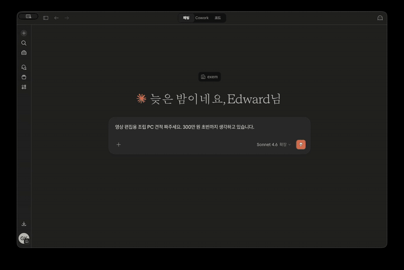
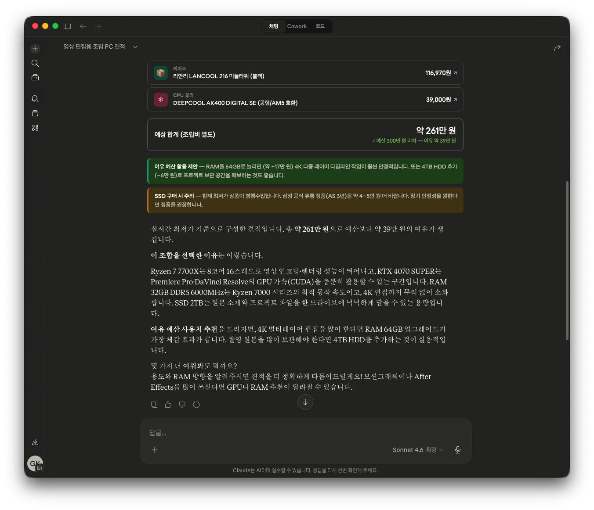
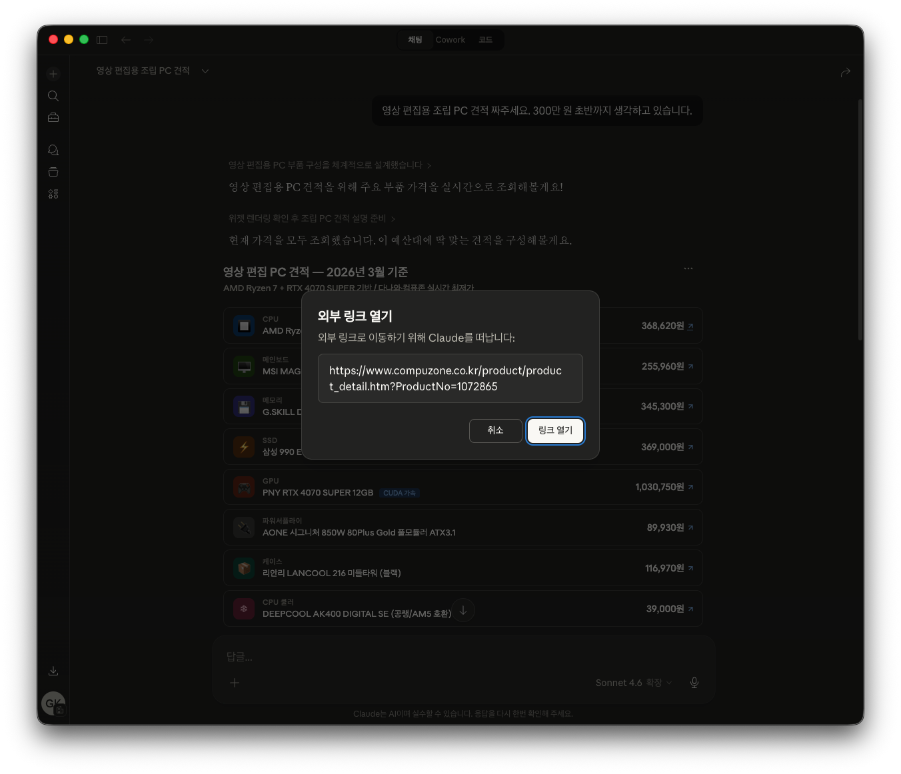
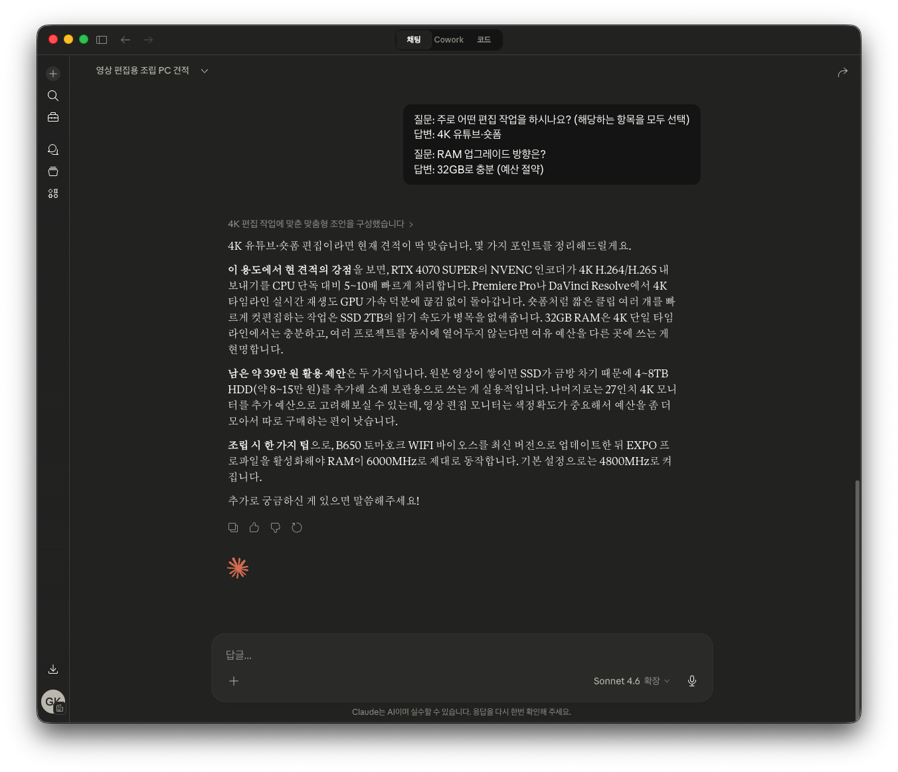

# kr-pc-deals-mcp

> AI한테 "100만원으로 게이밍 PC 짜줘"라고 하면, 다나와·에누리·견적왕·컴퓨존 실시간 가격을 비교해서 진짜 견적을 짜 줍니다.

한국 PC 부품 가격비교와 조립 견적 호환성 검사를 하는 MCP 서버입니다. Claude Desktop, Claude Code, Cursor처럼 로컬(stdio) MCP 서버를 지원하는 AI 앱에서 씁니다. API 키나 회원가입이 필요 없습니다.

## 데모

> "영상 편집용 조립 PC 견적" 요청 예시 (Claude Desktop, 5배속)









## 할 수 있는 일

- **부품 검색**: 가격비교 사이트 다나와·에누리·견적왕과 쇼핑몰 컴퓨존을 한 번에 검색합니다.
- **사이트 간 가격 비교**: 같은 제품끼리 묶어 어느 사이트가 얼마나 싼지 알려 줍니다. 모델번호·브랜드·제품군·용량·색상·포장(그래픽카드는 OC·SFF 표기까지)이 확실히 같을 때만 묶고, 포장이 안 적힌 CPU처럼 여러 제품 중 어느 것인지 알 수 없으면 묶지 않습니다.
- **최저가 찾기**: 검색어에 모델번호가 있으면 그 모델 중에서만, 용량(16GB 등)이 있으면 다른 용량이 적힌 상품을 빼고 가장 싼 상품을 고릅니다. 맞는 상품이 없으면 다른 모델로 대신하지 않고 없다고 알려 줍니다.
- **카테고리 인기 목록**: 다나와 인기 상품으로 후보를 넓게 봅니다.
- **상품 상세**: 스펙 요약과 판매처별 가격(현금가·카드가 구분)을 봅니다.
- **견적 검사**: 부품 목록의 합계, 빠진 필수 부품, CPU·메인보드·RAM 호환성(다나와 PC견적 기준)을 확인합니다.
- **가격 이력**: 다나와 최저가 변동을 봅니다 (1·3개월은 주 단위, 6·12·24개월은 월 단위). 한 주만 크게 떨어졌다 회복한 값은 판매처 등록 오류일 수 있어 따로 표시합니다. 다른 사이트는 가격 이력을 공개 페이지로 주지 않아 다나와만 됩니다.

## 빠른 시작

Node.js 20 이상이 필요합니다.

### Claude Desktop

`Settings` → `Developer` → `Edit Config`에서 `claude_desktop_config.json`을 열고 아래를 추가합니다.

```json
{
  "mcpServers": {
    "kr-pc-deals-mcp": {
      "command": "npx",
      "args": ["-y", "kr-pc-deals-mcp"]
    }
  }
}
```

### Claude Code

```bash
claude mcp add kr-pc-deals-mcp -- npx -y kr-pc-deals-mcp
```

### Cursor

프로젝트 루트에 `.cursor/mcp.json`을 만듭니다.

```json
{
  "mcpServers": {
    "kr-pc-deals-mcp": {
      "command": "npx",
      "args": ["-y", "kr-pc-deals-mcp"]
    }
  }
}
```

> ChatGPT는 원격(HTTP) MCP 서버만 연결할 수 있어서 이 서버(stdio)를 바로 쓸 수 없습니다.

## 사용 예시

AI에게 평소 말투로 물어보면 됩니다.

- "RTX 5070 Ti 검색해줘"
- "7800X3D 사이트별 가격 비교해줘"
- "DDR5 32GB 최저가 찾아줘"
- "요즘 많이 팔리는 그래픽카드 보여줘"
- "100만원으로 게이밍 PC 견적 짜줘"
- "이 견적 호환되는지 확인해줘"
- "이 제품 최근 3개월 가격 변동 보여줘"

## MCP 도구

모든 도구는 사이트를 읽기만 합니다 (`readOnlyHint`). 결과는 구조화된 JSON(`structuredContent`)이며 가격은 원 단위 정수, 0은 가격 미정입니다.

| 도구 | 하는 일 | 사이트 |
|---|---|---|
| `search_parts` | 키워드 검색. 상품명·가격·상품 코드·링크 | 다나와, 에누리, 견적왕, 컴퓨존 |
| `get_product_detail` | 스펙 요약과 판매처별 가격 | 다나와, 에누리, 견적왕, 컴퓨존 |
| `get_price_history` | 최저가 변동 (1·3개월 주 단위, 6·12·24개월 월 단위) | 다나와 |
| `compare_prices` | 같은 제품끼리 묶어 사이트별 가격 비교 (두 사이트 이상에서 찾은 제품만) | 다나와, 에누리, 견적왕, 컴퓨존 |
| `find_lowest_price` | 검색 결과 중 최저가 하나 (모델번호가 있으면 같은 모델만, 없으면 null) | 다나와, 에누리, 견적왕, 컴퓨존 |
| `list_by_category` | 카테고리 인기 상품 최대 30개 (가격순 정렬 가능) | 다나와 |
| `check_build` | 부품 목록의 합계, 빠진 필수 부품, 호환성 검사 | 다나와 |

다루는 부품: CPU, 그래픽카드, 메인보드, 메모리, SSD, HDD, 파워, 케이스, CPU 쿨러, 모니터

견적은 서버에 저장되지 않습니다. AI가 고른 부품 목록을 `check_build`에 통째로 넘겨 확인하므로, 여러 대화에서 동시에 견적을 짜도 섞이지 않습니다.

## 알아 둘 점

- 가격은 요청한 순간 사이트에 보이는 값입니다. 같은 검색은 30분 동안 저장된 결과를 씁니다. 실제 결제 가격은 판매처·카드 할인에 따라 다를 수 있습니다.
- 다나와 검색은 사이트의 요청 간격 규칙(10초)을 지키므로, 연달아 검색하면 몇 초씩 기다릴 수 있습니다.
- 가격비교 사이트(다나와·에누리·견적왕)의 가격은 판매처 최저가라 현금 결제가가 섞일 수 있습니다. 한 사이트만 유난히 싸면 상품 상세에서 판매처를 확인하세요.
- 카테고리 인기 목록에서 판매처 등록 오류로 보이는 가격(같은 상품의 다른 기준가의 절반 미만)에는 경고(`priceWarning`)를 붙입니다. 검색 결과에는 이 기준가가 없어 경고가 붙지 않으니, 지나치게 싼 가격은 링크에서 확인하세요.
- 상품 상세의 판매처 목록은 상위 판매처 최대 10곳입니다.
- 검색은 사이트마다 첫 페이지(다나와·에누리 40개, 컴퓨존 20개, 견적왕 10개)만 읽습니다.
- 공개 웹페이지를 읽는 방식이라, 사이트가 화면 구조를 바꾸면 일부 기능이 잠시 동작하지 않을 수 있습니다.

## 직접 실행·개발

```bash
git clone https://github.com/edward-kim-dev/kr-pc-deals-mcp.git
cd kr-pc-deals-mcp
npm install
npm test          # 네트워크 없이 고정 데이터로 테스트
npm run build     # dist/ 생성
npm start         # stdio 서버 실행
```

로컬 빌드를 AI 앱에 연결하려면 `command`를 `node`, `args`를 `["/절대경로/kr-pc-deals-mcp/dist/index.js"]`로 지정합니다 (`.mcp.json.example` 참고).

개발 규칙과 구조는 [AGENTS.md](AGENTS.md), 사이트별 데이터 주소와 파싱 위치는 [docs/data-sources.md](docs/data-sources.md)에 있습니다.

## 면책 조항

이 소프트웨어는 **개인적·비상업적 용도로만** 사용하세요.

- 이 도구는 다나와·에누리·견적왕·컴퓨존의 공개 웹페이지에서 가격 정보를 읽습니다. 각 사이트의 이용약관을 지킬 책임은 사용자에게 있습니다.
- 사이트에 부담을 주지 않도록 요청 간격·횟수를 제한하고 결과를 캐시합니다. 이 제한을 풀거나 과도하게 요청하지 마세요.
- 수집한 데이터를 상업적으로 쓰거나 재배포하지 마세요.
- 이 소프트웨어 사용으로 생긴 문제에 대해 개발자는 법적 책임을 지지 않습니다.
