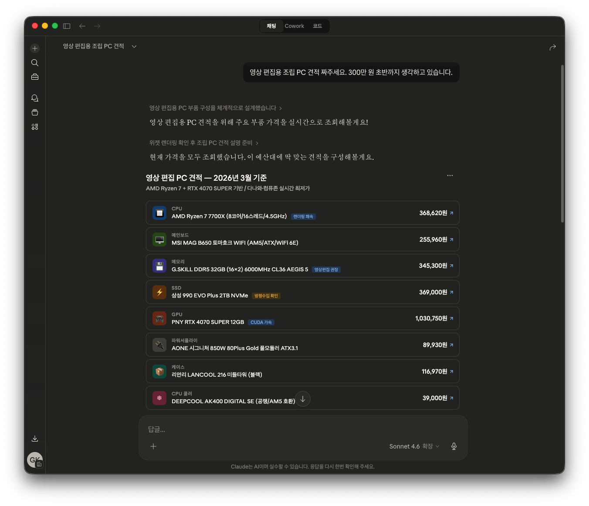
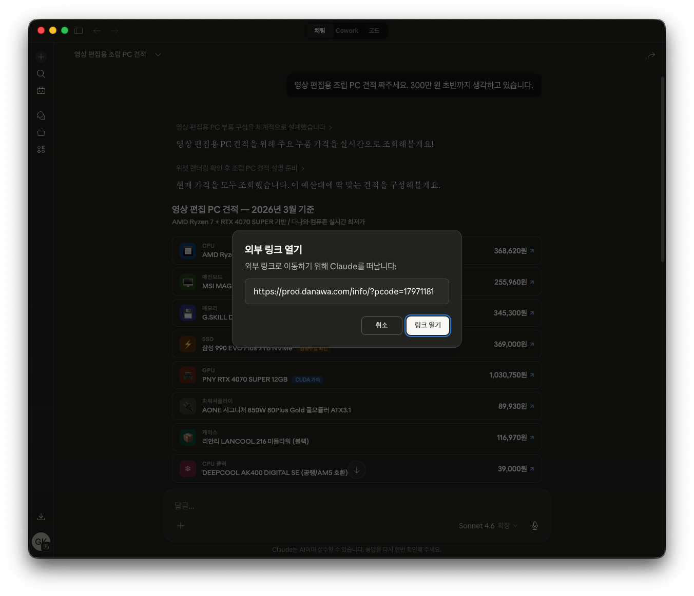

# kr-pc-deals-mcp

> AI한테 "100만원으로 게이밍 PC 짜줘"라고 하면, 다나와/컴퓨존 최저가를 비교해서 진짜 견적을 짜줍니다.

한국 PC 부품 가격비교 및 조립 견적 MCP 서버입니다.
Claude, ChatGPT, Cursor 등 MCP를 지원하는 모든 AI 앱에서 사용할 수 있습니다.

## 데모

> "영상 편집용 조립 PC 견적" 요청 예시 (Claude Desktop, 5배속)







## 주요 기능

- **부품 검색** — 다나와 + 컴퓨존 통합 검색
- **가격 비교** — 동일 제품의 크로스사이트 최저가 비교
- **가격 이력** — 다나와 가격 변동 추적 (1/3/6/12개월)
- **빌드 견적** — 부품을 하나씩 추가하며 견적 구성, 합계 자동 계산
- **호환성 체크** — 다나와 가상견적 API 기반 CPU-메인보드-RAM 호환성 자동 검증

---

## 빠른 시작

다나와/컴퓨존만 사용하려면 아래 설정으로 충분합니다. 쿠팡 데이터까지 활용하려면 [쿠팡 활성화](#쿠팡-활성화-선택) 섹션을 참고하세요.

### Claude Desktop

`Settings` → `Developer` → `Edit Config`에서 `claude_desktop_config.json`을 열고 아래를 추가:

```json
{
  "mcpServers": {
    "kr-pc-deals-mcp": {
      "command": "npx",
      "args": ["-y", "kr-pc-deals-mcp"]
    }
  }
}
```

### Claude Code

```bash
claude mcp add kr-pc-deals-mcp npx -- -y kr-pc-deals-mcp
```

### Cursor

프로젝트 루트에 `.cursor/mcp.json` 파일 생성:

```json
{
  "mcpServers": {
    "kr-pc-deals-mcp": {
      "command": "npx",
      "args": ["-y", "kr-pc-deals-mcp"]
    }
  }
}
```

---

## 쿠팡 활성화 (선택)

쿠팡 가격까지 비교에 포함하려면 쿠팡 파트너스 Open API 키가 필요합니다.

1. [쿠팡 파트너스](https://partners.coupang.com)에 가입하고 Open API 키를 발급받습니다.
2. MCP 클라이언트 설정의 `env` 필드에 키를 넣습니다.

### Claude Desktop / Cursor

```json
{
  "mcpServers": {
    "kr-pc-deals-mcp": {
      "command": "npx",
      "args": ["-y", "kr-pc-deals-mcp"],
      "env": {
        "COUPANG_ACCESS_KEY": "발급받은_access_key",
        "COUPANG_SECRET_KEY": "발급받은_secret_key"
      }
    }
  }
}
```

### Claude Code

```bash
claude mcp add kr-pc-deals-mcp \
  -e COUPANG_ACCESS_KEY=발급받은_access_key \
  -e COUPANG_SECRET_KEY=발급받은_secret_key \
  npx -- -y kr-pc-deals-mcp
```

> 두 키가 **모두** 설정되어야 쿠팡 검색이 활성화됩니다. 하나만 있으면 비활성 상태로 동작합니다.

---

## 직접 설치

### 요구사항

- Node.js 20 이상
- npm 또는 yarn

### 설치

```bash
git clone https://github.com/yourname/kr-pc-deals-mcp.git
cd kr-pc-deals-mcp
npm install
```

### 빌드

```bash
npm run build
```

### 실행

```bash
# 개발 모드 (TypeScript 직접 실행)
npm run dev

# 프로덕션 모드
npm run build
npm start
```

### 테스트

```bash
npm test
```

---

## 환경 변수

기본 사용에는 환경변수가 필요 없습니다. 다나와/컴퓨존은 키 없이 동작합니다.

선택적으로 사용할 수 있는 환경변수:

| 변수 | 설명 | 기본값 |
|------|------|--------|
| `COUPANG_ACCESS_KEY` | 쿠팡 파트너스 Open API access key | 미설정 (쿠팡 데이터 비활성) |
| `COUPANG_SECRET_KEY` | 쿠팡 파트너스 Open API secret key | 미설정 (쿠팡 데이터 비활성) |

### 환경변수 전달 방법

| 실행 방식 | 전달 방법 |
|---|---|
| **npx (Claude Desktop/Code/Cursor 등 MCP 클라이언트)** | 클라이언트 설정 파일의 `env` 필드에 직접 입력 — [쿠팡 활성화](#쿠팡-활성화-선택) 참고 |
| **로컬 개발 (`git clone` 후 `npm run dev`)** | 프로젝트 루트에 `.env` 파일 생성 (`cp .env.example .env`) |

> `.env` 파일은 로컬 개발 시에만 자동 로드됩니다. npx로 실행되는 MCP 서버는 `.env`를 찾을 수 없으므로, 반드시 MCP 클라이언트 설정의 `env` 필드를 사용하세요.

---

## 사용 예시

Claude나 Cursor에서 아래처럼 자연어로 질문하면 됩니다:

### 부품 검색
> "RTX 4070 SUPER 검색해줘"
> "i7-14700K 다나와에서 찾아봐"

### 가격 비교
> "RTX 4070 SUPER 다나와랑 컴퓨존 가격 비교해줘"
> "DDR5 32GB 최저가 찾아줘"

### PC 견적
> "100만원으로 게이밍 PC 견적 짜줘"
> "200만원 영상편집용 PC 추천해줘"

### 호환성 체크
> "이 견적 호환성 체크해줘"
> "지금 빌드에 추가한 부품들 호환되는지 확인해줘"

### 가격 이력
> "이 제품 최근 3개월 가격 변동 보여줘"

---

## MCP 도구 목록

### 검색

| 도구 | 설명 |
|------|------|
| `search_parts` | PC 부품 키워드 검색 (다나와/컴퓨존/쿠팡/전체) |
| `get_product_detail` | 상품 상세 정보 (스펙, 판매처별 가격) |
| `get_price_history` | 가격 변동 이력 (1/3/6/12개월) |

### 가격 비교

| 도구 | 설명 |
|------|------|
| `compare_prices` | 다나와/컴퓨존/쿠팡 동일 제품 가격 비교 |
| `find_lowest_price` | 통합 최저가 검색 |
| `list_by_category` | 카테고리별 인기/최저가 목록 |

### 빌드 (견적)

| 도구 | 설명 |
|------|------|
| `build_add` | 빌드에 부품 추가 (2개 이상 시 호환성 자동 체크) |
| `build_remove` | 빌드에서 부품 제거 |
| `build_status` | 현재 빌드 상태 조회 |
| `build_check_compatibility` | 다나와 API 기반 부품 간 호환성 체크 |

### 지원 카테고리

CPU, 그래픽카드, 메인보드, RAM, SSD, HDD, 파워서플라이, 케이스, CPU 쿨러, 모니터

---

## 아키텍처

```
사용자 (Claude/Cursor/ChatGPT)
  ↓ MCP Protocol (stdio)
kr-pc-deals-mcp Server
  ├── 다나와 Provider (검색, 상세, 가격이력, 가상견적, 호환성 API)
  ├── 컴퓨존 Provider (검색, 상세)
  ├── 쿠팡 Provider (선택, 파트너스 Open API)
  └── 가격 비교 Service (크로스사이트 매칭)
```

### 차단 방지 메커니즘

| 단계 | 설명 |
| ------ | ------ |
| 사이트별 동시성 제어 | 다나와 최대 3건/500ms, 컴퓨존 최대 2건/1,000ms |
| 인메모리 캐시 | 동일 검색 결과 재사용 |
| 지수 백오프 | 차단 시 30초 → 60초 → 120초 → 최대 5분 |

---

## 개발

```bash
# TypeScript 타입 체크
npx tsc --noEmit

# 테스트
npm test

# 테스트 (watch 모드)
npm run test:watch

# 빌드
npm run build
```

---

## 면책 조항

이 소프트웨어는 **개인적, 비상업적 용도로만** 사용하십시오.

- 이 도구는 공개된 웹페이지의 가격 정보를 수집합니다.
- 다나와 및 컴퓨존의 이용약관을 준수할 책임은 **사용자 본인**에게 있습니다.
- 과도한 요청으로 서버에 부하를 주는 행위는 금지합니다.
- 수집한 데이터를 상업적으로 활용하거나 재배포하는 행위는 금지합니다.
- 이 소프트웨어 사용으로 인한 법적 책임은 개발자가 지지 않습니다.

---

## 라이선스

MIT

---

## 참고

이 프로젝트는 [daiso-mcp](https://github.com/hmmhmmhm/daiso-mcp)의 아키텍처 패턴을 참고하여 개발되었습니다.

### 관련 리소스
- [Danawa-Crawler](https://github.com/sammy310/Danawa-Crawler) — 다나와 PC 부품 크롤러 (Python)
- [danawa-py](https://github.com/MineEric64/danawa-py) — 다나와 Python 라이브러리
- [awesome-mcp-servers](https://github.com/punkpeye/awesome-mcp-servers) — MCP 서버 목록
